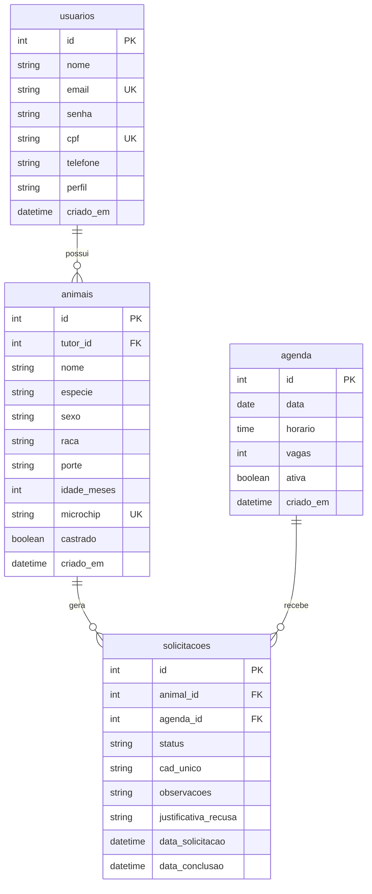

# CastraPet - Sistema de Agendamento e Controle de Castração Animal

Sistema web desenvolvido para gestão de solicitações de castração, identificação eletrônica por microchip e controle de cotas em parceria com clínicas veterinárias conveniadas.

---

## Contextualização e Problema Identificado

No âmbito da gestão de saúde pública e controle populacional de cães e gatos, o município oferece programas de castração gratuita voltados a famílias em situação de vulnerabilidade social. 

Apesar do impacto positivo, o fluxo atual de atendimento enfrenta gargalos operacionais:
* **Falta de Centralização:** O controle de solicitações, cotas mensais das clínicas parceiras e fila de espera é gerido manualmente ou por planilhas descentralizadas.
* **Falta de Rastreabilidade e Identificação:** Animais castrados nem sempre possuem um registro único digital associado ao número do transponder (microchip) inserido no momento da cirurgia, dificultando a fiscalização de abandono e o acompanhamento do histórico do animal.
* **Comunicação Falha com o Tutor:** Inexistência de um guia claro e padronizado com orientações pré-operatórias (como jejum hídrico/alimentar, transporte e documentos necessários), resultando em faltas no dia agendado ou procedimentos cancelados por desconhecimento das regras.

---

## Proposta de Solução

O CastraPet é um sistema web completo em arquitetura Full-Stack que automatiza o ciclo de vida do programa de castração municipal:
1. Permite ao **Tutor/Cidadão** realizar a solicitação online, consultar orientações pré-operatórias e emitir a Guia de Encaminhamento.
2. Disponibiliza para a **Prefeitura (Veterinário/Gestor Municipal)** o controle da fila de triagem, aprovação de cadastros, gerenciamento da cota diária/mensal das clínicas e emissão de relatórios de controle animal.
3. Garante à **Clínica Conveniada** um painel para registrar o atendimento, realizar o check-in do animal, efetuar o vínculo do número do microchip aplicado e dar baixa no procedimento.

---

## Principais Funcionalidades Previstas

- **Gestão de Acesso:** Cadastro, autenticação com JWT e controle de permissões por perfil (`ADMIN`, `CLINICA`, `TUTOR`).
- **Solicitação e Agendamento:** Cadastro de animais vinculado ao tutor e vinculação à clínica conveniada com vaga disponível.
- **Módulo de Microchipagem:** Campo de identificação única do transponder registrado pela clínica pós-procedimento.
- **Manual e Guia Pré-Operatória:** Instruções claras ao tutor sobre o transporte, documentos e jejum do animal.
- **Painel de Triagem:** Interface administrativa para validação das solicitações e gestão de cotas.

---

## Tipos de Usuários e Ações Previstas

| Perfil de Usuário | Permissões e Ações no Sistema |
| :--- | :--- |
| **Cidadão / Tutor** (`TUTOR`) | • Realizar cadastro na plataforma.<br>• Solicitar agendamento de castração informando dados do animal.<br>• Visualizar status da solicitação (Pendente, Aprovado, Concluído).<br>• Acessar a Guia Pré-Operatória com instruções para o dia do procedimento. |
| **Gestor Municipal / Prefeitura** (`ADMIN`) | • Triar e aprovar/recusar solicitações com base na vulnerabilidade.<br>• Cadastrar e gerenciar clínicas parceiras e suas cotas de atendimento.<br>• Visualizar dashboard geral de animais atendidos e microchipados.<br>• Gerenciar todos os cadastros de tutores e animais. |
| **Clínica Conveniada** (`CLINICA`) | • Visualizar a agenda de animais confirmados para a data.<br>• Confirmar presença/check-in do animal na clínica.<br>• Cadastrar o número do microchip aplicado durante o procedimento.<br>• Concluir o atendimento no sistema. |

---

## Fluxo Básico de Funcionamento

```text
[Tutor] Cadastra-se e solicita castração do animal no sistema
   │
   ▼
[Prefeitura / ADMIN] Analisa solicitação na fila de triagem
   │
   ├──▶ (Recusado) ──▶ Notifica tutor com a justificativa
   │
   ▼ (Aprovado)
[Sistema] Aloca vaga na Clínica Conveniada e gera Guia Pré-Operatória para o Tutor
   │
   ▼
[Tutor] Leva o animal à Clínica na data agendada conforme instruções pré-operatórias
   │
   ▼
[Clínica] Realiza a cirurgia, aplica o microchip e registra o NÚMERO DO MICROCHIP na plataforma
   │
   ▼
[Sistema] Finaliza o agendamento e atualiza o histórico do animal como "Castrado e Microchipado"
```

---

## Agenda de Atendimento

A organização dos agendamentos é feita por uma **agenda de dias e horários**, que sustenta as etapas do fluxo acima:

- A clínica conveniada cadastra os dias e horários em que atende e quantas **vagas** há em cada um.
- Ao solicitar a castração, o tutor escolhe um horário que ainda tenha vaga.
- A prefeitura aprova ou recusa a solicitação na triagem; se recusar, a vaga volta para a agenda.
- O sistema não permite marcar mais animais do que as vagas de cada horário.

**Status de uma solicitação:** `PENDENTE` → `APROVADO` → `CHECKIN` → `CONCLUIDO` (ou `RECUSADO` / `CANCELADO`).

---

## Tecnologias

| Camada | Tecnologias |
| :--- | :--- |
| Front-end *(previsto para a Entrega 3)* | HTML5, CSS3, JavaScript (manipulação do DOM e Fetch API) |
| Back-end | Node.js, Express |
| Banco de dados | MySQL (`mysql2`) |
| Autenticação | JWT (`jsonwebtoken`) e `bcryptjs` |
| Outros | `dotenv`, `cors` |

---

## Estrutura do Projeto

```text
projeto-web-tecnico-senac/
├── backend/
│   ├── server.js
│   ├── routes/            
│   ├── controllers/       
│   ├── middlewares/       
│   ├── database/          
│   ├── .env.example
│   ├── .gitignore
│   └── package.json
├── frontend/              
├── sql/
│   ├── castrapet.sql      
│   └── dados_teste.sql    
├── .gitignore
└── README.md
```

O back-end separa responsabilidades: **routes** (endereços), **controllers** (regras e acesso ao banco), **middlewares** (autenticação, autorização e CORS) e **database** (conexão).

---

## Banco de Dados

Banco `castrapet` (MySQL, InnoDB) com 4 tabelas relacionadas.

**Legenda:** `PK` chave primária · `FK` chave estrangeira · `UK` valor único.



### Relacionamentos

| Relação | Cardinalidade | Chave estrangeira |
| :--- | :---: | :--- |
| `usuarios` → `animais` | 1 : N | `animais.tutor_id` → `usuarios.id` |
| `animais` → `solicitacoes` | 1 : N | `solicitacoes.animal_id` → `animais.id` |
| `agenda` → `solicitacoes` | 1 : N | `solicitacoes.agenda_id` → `agenda.id` |

### Detalhes dos campos

| Campo | Valores / regra |
| :--- | :--- |
| `usuarios.senha` | Hash bcrypt (a senha original nunca é salva) |
| `usuarios.perfil` | `ADMIN`, `CLINICA`, `TUTOR` (padrão: `TUTOR`) |
| `animais.especie` | `CAO`, `GATO` |
| `animais.sexo` | `MACHO`, `FEMEA` |
| `animais.porte` | `PEQUENO`, `MEDIO`, `GRANDE` |
| `animais.microchip` | Único no sistema; preenchido pela clínica após a cirurgia |
| `agenda` | Restrição `UNIQUE (data, horario)` e `vagas > 0` |
| `solicitacoes.status` | `PENDENTE`, `APROVADO`, `RECUSADO`, `CHECKIN`, `CONCLUIDO`, `CANCELADO` |

Scripts: [`sql/castrapet.sql`](sql/castrapet.sql) (estrutura) e [`sql/dados_teste.sql`](sql/dados_teste.sql) (dados de demonstração).

---

## Como Executar

**Pré-requisitos:** Node.js 20+, npm e MySQL 8.0.16+.

1. **Clone o repositório**
   ```bash
   git clone https://github.com/rafamarques09/projeto-web-tecnico-senac.git
   cd projeto-web-tecnico-senac
   ```
2. **Crie o banco:** no MySQL Workbench, execute `sql/castrapet.sql` e depois `sql/dados_teste.sql`.
3. **Entre na pasta do backend**
   ```bash
   cd backend
   ```
5. **Instale as dependências**
   ```bash
   npm install
   ```
6. **Configure o ambiente:** copie `backend/.env.example` para `backend/.env` e preencha:
   - `DB_PASSWORD`: a senha do seu MySQL.
   - `JWT_SECRET`: um segredo longo (mínimo 32 caracteres), gerado com:
     ```bash
     node -e "console.log(require('crypto').randomBytes(48).toString('hex'))"
     ```
7. **Inicie o servidor**
   ```bash
   npm run dev
   ```
8. A API fica disponível em **http://localhost:3000**. Como a interface (front-end) ainda não foi desenvolvida, teste as rotas pelo **Postman** ou **Thunder Client**.

**Contas de demonstração** (apenas para uso local):

| Perfil | E-mail | Senha |
| :--- | :--- | :--- |
| `ADMIN` | admin@castrapet.com | Admin@123 |
| `CLINICA` | clinica@castrapet.com | Clinica@123 |
| `TUTOR` | tutor@castrapet.com | Tutor@123 |

---

## Autenticação e Segurança

- **Senhas** guardadas como hash **bcrypt**; a senha original nunca é salva.
- **Login** valida as credenciais e devolve um **JWT** (HS256, expira em 2h por padrão), enviado depois no cabeçalho `Authorization: Bearer <token>`.
- **Cadastro público** cria sempre um usuário `TUTOR`. Os perfis `CLINICA` e `ADMIN` só são concedidos por um administrador.
- **Middlewares:**
  - `autenticacaoMiddleware`: valida o token e carrega o usuário, lendo o perfil do banco a cada requisição.
  - `autorizacaoMiddleware('PERFIL', ...)`: libera a rota apenas para os perfis informados.
  - `corsMiddleware`: define quais origens do navegador podem chamar a API.
- **As permissões são verificadas na API**, não apenas escondendo botões ou páginas no front-end.
- **SQL Injection:** todas as consultas usam parâmetros (`?`).
- A mensagem de erro do login é a mesma para e-mail inexistente e senha incorreta.
- **Regra de negócio:** o sistema não permite remover o último administrador.
- `.env`, `node_modules` e credenciais não são enviados ao GitHub (`.gitignore`).

---

## Rotas da API

| Método | Rota | Acesso | Descrição | Respostas |
| :--- | :--- | :--- | :--- | :--- |
| `POST` | `/auth/cadastro` | Público | Cadastra um tutor | 201, 400, 409 |
| `POST` | `/auth/login` | Público | Autentica e devolve o JWT | 200, 400, 401 |
| `GET` | `/auth/perfil` | Logado | Dados do usuário autenticado | 200, 401 |
| `GET` | `/usuarios` | `ADMIN` | Lista os usuários (sem senha) | 200, 401, 403 |
| `PUT` | `/usuarios/:id/perfil` | `ADMIN` | Altera o perfil de um usuário | 200, 400, 401, 403, 404, 409 |

---

## Andamento do Projeto

- [x] **Entrega 1:** problema, proposta e estrutura inicial
- [x] **Entrega 2:** banco de dados, cadastro e login (via API), JWT, perfis e middlewares
- [ ] **Entrega 3:** interface (HTML, CSS e JavaScript com DOM e Fetch) e CRUD completo (animais, agenda e solicitações), com as regras de negócio:
  - não permitir solicitações em horário sem vaga (com transação para evitar conflito entre pedidos simultâneos);
  - não permitir horários fechados ou no passado;
  - um animal não pode ter dois pedidos abertos nem ser castrado duas vezes;
  - o microchip é único no sistema;
  - permissões por perfil verificadas na API.
- [ ] **Entrega 4:** funcionalidades finais (Guia Pré-Operatória, painel da prefeitura, microchipagem), tratamento de erros, documentação final e apresentação
