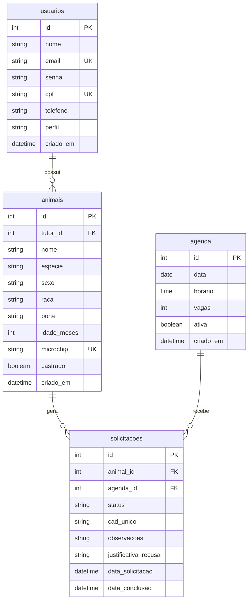
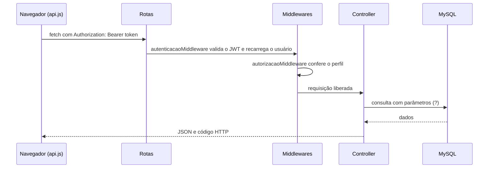

# CastraPet - Sistema de Agendamento e Controle de Castração Animal

Sistema web desenvolvido para gestão de solicitações de castração, identificação eletrônica por microchip e controle de cotas em parceria com clínicas veterinárias conveniadas.

**Sumário**

1. [Contextualização e Problema Identificado](#contextualização-e-problema-identificado)
2. [Proposta de Solução](#proposta-de-solução)
3. [Principais Funcionalidades Previstas](#principais-funcionalidades-previstas)
4. [Tipos de Usuários e Ações Previstas](#tipos-de-usuários-e-ações-previstas)
5. [Fluxo Básico de Funcionamento](#fluxo-básico-de-funcionamento)
6. [Agenda de Atendimento](#agenda-de-atendimento)
7. [Tecnologias](#tecnologias)
8. [Estrutura do Projeto](#estrutura-do-projeto)
9. [Banco de Dados](#banco-de-dados)
10. [Como Executar](#como-executar)
11. [Autenticação e Segurança](#autenticação-e-segurança)
12. [Rotas da API](#rotas-da-api)
13. [Permissões por Perfil](#permissões-por-perfil)
14. [Regras de Negócio](#regras-de-negócio)
15. [Como Testar](#como-testar)
16. [Limitações Conhecidas](#limitações-conhecidas)
17. [Andamento do Projeto](#andamento-do-projeto)

---

## Contextualização e Problema Identificado

No âmbito da gestão de saúde pública e controle populacional de cães e gatos, o município oferece programas de castração gratuita voltados a famílias em situação de vulnerabilidade social. 

Apesar do impacto positivo, o fluxo atual de atendimento enfrenta gargalos operacionais:
* **Falta de Centralização:** O controle de solicitações, cotas mensais das clínicas parceiras e fila de espera é gerido manualmente ou por planilhas descentralizadas.
* **Falta de Rastreabilidade e Identificação:** Animais castrados nem sempre possuem um registro único digital associado ao número do transponder (microchip) inserido no momento da cirurgia, dificultando a fiscalização de abandono e o acompanhamento do histórico do animal.
* **Comunicação Falha com o Tutor:** Inexistência de um guia claro e padronizado com orientações pré-operatórias (como jejum hídrico/alimentar, transporte e documentos necessários), resultando em faltas no dia agendado ou procedimentos cancelados por desconhecimento das regras.

---

## Proposta de Solução

O CastraPet é um sistema web completo em arquitetura Full-Stack que automatiza o ciclo de vida do programa de castração municipal:
1. Permite ao **Tutor/Cidadão** realizar a solicitação online, consultar orientações pré-operatórias e emitir a Guia de Encaminhamento.
2. Disponibiliza para a **Prefeitura (Veterinário/Gestor Municipal)** o controle da fila de triagem, aprovação de cadastros, gerenciamento da cota diária/mensal das clínicas e emissão de relatórios de controle animal.
3. Garante à **Clínica Conveniada** um painel para registrar o atendimento, realizar o check-in do animal, efetuar o vínculo do número do microchip aplicado e dar baixa no procedimento.

---

## Principais Funcionalidades Previstas

- **Gestão de Acesso:** Cadastro, autenticação com JWT e controle de permissões por perfil (`ADMIN`, `CLINICA`, `TUTOR`).
- **Solicitação e Agendamento:** Cadastro de animais vinculado ao tutor e vinculação à clínica conveniada com vaga disponível.
- **Módulo de Microchipagem:** Campo de identificação única do transponder registrado pela clínica pós-procedimento.
- **Manual e Guia Pré-Operatória:** Instruções claras ao tutor sobre o transporte, documentos e jejum do animal.
- **Painel de Triagem:** Interface administrativa para validação das solicitações e gestão de cotas.

---

## Tipos de Usuários e Ações Previstas

| Perfil de Usuário | Permissões e Ações no Sistema |
| :--- | :--- |
| **Cidadão / Tutor** (`TUTOR`) | • Realizar cadastro na plataforma.<br>• Solicitar agendamento de castração informando dados do animal.<br>• Visualizar status da solicitação (Pendente, Aprovado, Concluído).<br>• Acessar a Guia Pré-Operatória com instruções para o dia do procedimento. |
| **Gestor Municipal / Prefeitura** (`ADMIN`) | • Triar e aprovar/recusar solicitações com base na vulnerabilidade.<br>• Cadastrar e gerenciar clínicas parceiras e suas cotas de atendimento.<br>• Visualizar dashboard geral de animais atendidos e microchipados.<br>• Gerenciar todos os cadastros de tutores e animais. |
| **Clínica Conveniada** (`CLINICA`) | • Visualizar a agenda de animais confirmados para a data.<br>• Confirmar presença/check-in do animal na clínica.<br>• Cadastrar o número do microchip aplicado durante o procedimento.<br>• Concluir o atendimento no sistema. |

---

## Fluxo Básico de Funcionamento

```text
[Tutor] Cadastra-se e solicita castração do animal no sistema
   │
   ▼
[Prefeitura / ADMIN] Analisa solicitação na fila de triagem
   │
   ├──▶ (Recusado) ──▶ Notifica tutor com a justificativa
   │
   ▼ (Aprovado)
[Sistema] Aloca vaga na Clínica Conveniada e gera Guia Pré-Operatória para o Tutor
   │
   ▼
[Tutor] Leva o animal à Clínica na data agendada conforme instruções pré-operatórias
   │
   ▼
[Clínica] Realiza a cirurgia, aplica o microchip e registra o NÚMERO DO MICROCHIP na plataforma
   │
   ▼
[Sistema] Finaliza o agendamento e atualiza o histórico do animal como "Castrado e Microchipado"
```

---

## Agenda de Atendimento

A organização dos agendamentos é feita por uma **agenda de dias e horários**, que sustenta as etapas do fluxo acima:

- A clínica conveniada cadastra os dias e horários em que atende e quantas **vagas** há em cada um.
- Ao solicitar a castração, o tutor escolhe um horário que ainda tenha vaga.
- A prefeitura aprova ou recusa a solicitação na triagem; se recusar, a vaga volta para a agenda.
- O sistema não permite marcar mais animais do que as vagas de cada horário.

**Status de uma solicitação:** `PENDENTE` → `APROVADO` → `CHECKIN` → `CONCLUIDO` (ou `RECUSADO` / `CANCELADO`).

---

## Tecnologias

| Camada | Tecnologias |
| :--- | :--- |
| Front-end | HTML5, CSS3, JavaScript (manipulação do DOM e Fetch API) |
| Back-end | Node.js, Express |
| Banco de dados | MySQL (`mysql2`) |
| Autenticação | JWT (`jsonwebtoken`) e `bcryptjs` |
| Outros | `dotenv`, `cors` |

### Atualização das tecnologias e dependências

| Pacote (`backend/package.json`) | Função no projeto |
| :--- | :--- |
| `express` | Servidor HTTP, rotas e entrega dos arquivos do front-end |
| `mysql2` | Conexão com o MySQL (pool de conexões e consultas parametrizadas) |
| `bcryptjs` | Geração e comparação do hash das senhas |
| `jsonwebtoken` | Geração e validação do token JWT |
| `dotenv` | Leitura das variáveis do arquivo `.env` |
| `cors` | Controle das origens autorizadas a chamar a API |

**Scripts disponíveis** (executar dentro de `backend/`):

| Comando | O que faz |
| :--- | :--- |
| `npm run dev` | Inicia o servidor com reinício automático ao salvar arquivos (`node --watch`) |
| `npm start` | Inicia o servidor normalmente (`node server.js`) |
| `npm run seed` | Cria as três contas de demonstração (`ADMIN`, `CLINICA` e `TUTOR`), sem duplicar as que já existem |

O front-end não usa bibliotecas externas de JavaScript. A única dependência externa carregada pelo navegador é a fonte do Google Fonts (Inter e Manrope).

---

## Estrutura do Projeto

```text
projeto-web-tecnico-senac/
├── backend/
│   ├── server.js
│   ├── routes/            authRoutes, usuariosRoutes, animaisRoutes, agendaRoutes, solicitacoesRoutes
│   ├── controllers/       authController, usuariosController, animaisController, agendaController, solicitacoesController
│   ├── middlewares/       autenticacaoMiddleware, autorizacaoMiddleware, corsMiddleware
│   ├── database/          conexao.js, seed.js
│   ├── .env.example
│   ├── .gitignore
│   └── package.json
├── frontend/
│   ├── index.html, login.html, cadastro.html                    páginas públicas
│   ├── tutor.html, animais.html, solicitar.html,
│   │   solicitacoes.html, guia.html                             área do tutor
│   ├── clinica.html, agenda.html, atendimentos.html             área da clínica
│   ├── admin.html, triagem.html, usuarios.html,
│   │   animais-admin.html                                       área da prefeitura
│   ├── perfil.html                                              comum aos três perfis
│   ├── css/               style.css, layout.css, components.css, auth.css
│   ├── js/                config, api, utils, icons, components + um script por página
│   └── assets/icons/      favicon.svg, NOTICE.md
├── sql/
│   ├── agendamentoCastrapet.sql    estrutura do banco
│   └── dadosTeste.sql              dados de demonstração
└── README.md
└── INICIO-RAPIDO.md
```

O back-end separa responsabilidades: **routes** (endereços), **controllers** (regras e acesso ao banco), **middlewares** (autenticação, autorização e CORS) e **database** (conexão).

### Complemento da estrutura

- O arquivo **`INICIO-RAPIDO.md`** (na raiz) é um guia curto com o resumo do projeto, o passo a passo para rodar e uma tabela de problemas comuns.
- O **`.gitignore`** fica em `backend/` e impede o envio de `.env`, `node_modules/` e `*.log` ao GitHub. O arquivo `backend/.env.example` mostra quais variáveis precisam ser configuradas, sem conter nenhum segredo.
- O servidor Express entrega a pasta `frontend/` (`express.static`). A raiz `/` redireciona para `login.html`.

**Organização do front-end (`frontend/js/`):**

| Arquivo | Responsabilidade |
| :--- | :--- |
| `config.js` | Configuração geral (endereço base da API e dados institucionais opcionais) |
| `api.js` | Sessão do usuário (`Sessao`) e único ponto de requisições `fetch` (`Api.get`, `Api.post`, `Api.put`, `Api.del`), que já envia o token no cabeçalho `Authorization` |
| `utils.js` | Máscaras de CPF e telefone, validações, avisos e mensagens na tela |
| `components.js` | Estrutura comum das telas internas (menu lateral por perfil), tabelas, janelas modais e confirmações |
| `icons.js` | Ícones em SVG |
| demais arquivos | Um script por página (por exemplo, `animais.js`, `triagem.js`, `agenda.js`) |

**Páginas do sistema:**

| Perfil | Página | O que o usuário faz nela |
| :--- | :--- | :--- |
| Público | `index.html` | Apresenta o programa, como solicitar o atendimento, orientações e perguntas frequentes |
| Público | `cadastro.html` | Cria a conta de tutor, com máscara e validação de CPF, telefone e senha |
| Público | `login.html` | Entra no sistema e é levado ao painel do seu perfil |
| `TUTOR` | `tutor.html` | Visão geral: indicadores, próximo atendimento e histórico recente |
| `TUTOR` | `animais.html` | Cadastra, edita e exclui os próprios animais |
| `TUTOR` | `solicitar.html` | Assistente em 4 etapas: animal, data e horário, detalhes e revisão |
| `TUTOR` | `solicitacoes.html` | Acompanha as solicitações, filtra por situação, cancela ou exclui |
| `TUTOR` | `guia.html` | Consulta o encaminhamento e a guia pré-operatória, com opção de imprimir |
| `ADMIN` | `admin.html` | Painel com indicadores e gráfico de solicitações por situação |
| `ADMIN` | `triagem.html` | Aprova ou recusa solicitações (a recusa exige justificativa) |
| `ADMIN` | `usuarios.html` | Lista e busca usuários e altera o perfil de acesso |
| `ADMIN` | `animais-admin.html` | Consulta geral dos animais, com busca, filtros e paginação |
| `ADMIN` e `CLINICA` | `agenda.html` | Calendário e cadastro, edição, fechamento e exclusão de horários |
| `CLINICA` | `clinica.html` | Painel com os atendimentos do dia e os próximos procedimentos |
| `CLINICA` | `atendimentos.html` | Registra o check-in e conclui o atendimento com o número do microchip |
| Todos | `perfil.html` | Mostra os dados da conta e a descrição do perfil de acesso |

As telas internas só abrem para o perfil correto: quem não está logado volta ao login, e quem tenta abrir a página de outro perfil é levado ao próprio painel. Esse controle no navegador é apenas conveniência; **a segurança de verdade está na API**, que valida o token e o perfil em cada requisição.

---

## Banco de Dados

Banco `castrapet` (MySQL, InnoDB) com 4 tabelas relacionadas.

**Legenda:** `PK` chave primária · `FK` chave estrangeira · `UK` valor único.



### Relacionamentos

| Relação | Cardinalidade | Chave estrangeira |
| :--- | :---: | :--- |
| `usuarios` → `animais` | 1 : N | `animais.tutor_id` → `usuarios.id` |
| `animais` → `solicitacoes` | 1 : N | `solicitacoes.animal_id` → `animais.id` |
| `agenda` → `solicitacoes` | 1 : N | `solicitacoes.agenda_id` → `agenda.id` |

### Detalhes dos campos

| Campo | Valores / regra |
| :--- | :--- |
| `usuarios.senha` | Hash bcrypt (a senha original nunca é salva) |
| `usuarios.perfil` | `ADMIN`, `CLINICA`, `TUTOR` (padrão: `TUTOR`) |
| `animais.especie` | `CAO`, `GATO` |
| `animais.sexo` | `MACHO`, `FEMEA` |
| `animais.porte` | `PEQUENO`, `MEDIO`, `GRANDE` |
| `animais.microchip` | Único no sistema; preenchido pela clínica após a cirurgia |
| `agenda` | Restrição `UNIQUE (data, horario)` e `vagas > 0` |
| `solicitacoes.status` | `PENDENTE`, `APROVADO`, `RECUSADO`, `CHECKIN`, `CONCLUIDO`, `CANCELADO` |

Scripts: [`sql/agendamentoCastrapet.sql`](sql/agendamentoCastrapet.sql) (estrutura) e [`sql/dadosTeste.sql`](sql/dadosTeste.sql) (dados de demonstração).

### Arquivos SQL do repositório

| Arquivo | Conteúdo | Ordem |
| :--- | :--- | :---: |
| `sql/agendamentoCastrapet.sql` | Cria o banco `castrapet` (utf8mb4) e as 4 tabelas, com chaves, índices, `UNIQUE`, `CHECK` e `ENUM` | 1º |
| `sql/dadosTeste.sql` | Insere as 3 contas de demonstração (senhas já em hash bcrypt), 5 horários de agenda a partir da data atual, 2 animais e 1 solicitação pendente | 2º |

O `agendamentoCastrapet.sql` pode ser executado novamente sem problemas (usa `IF NOT EXISTS`). O `dadosTeste.sql` não duplica as contas nem os horários, mas **cadastra de novo os animais e a solicitação de exemplo**; por isso, execute-o uma única vez em cada banco.

**Decisões de modelagem:**

- Os três perfis ficam na tabela `usuarios`, no campo `perfil`, em vez de uma tabela para cada tipo de usuário.
- Todas as chaves estrangeiras usam o mecanismo `InnoDB`, que garante a integridade entre as tabelas. Por isso não é possível apagar um animal que tenha solicitações, nem um horário usado por uma solicitação (o sistema também trata isso na API, com mensagem clara).
- O microchip é `UNIQUE` e começa vazio: só a clínica o preenche, ao concluir o atendimento.
- O horário da agenda é único por data e hora (`UNIQUE (data, horario)`), e `vagas` precisa ser maior que zero (`CHECK`).

---

## Como Executar

**Pré-requisitos:** Node.js 20+, npm e MySQL 8.0.16+.

1. **Clone o repositório**
   ```bash
   git clone https://github.com/rafamarques09/projeto-web-tecnico-senac.git
   cd projeto-web-tecnico-senac
   ```
2. **Crie o banco:** no MySQL Workbench, execute `sql/agendamentoCastrapet.sql` e depois `sql/dadosTeste.sql`.
3. **Entre na pasta do backend**
   ```bash
   cd backend
   ```
5. **Instale as dependências**
   ```bash
   npm install
   ```
6. **Configure o ambiente:** copie `backend/.env.example` para `backend/.env` e preencha:
   - `DB_PASSWORD`: a senha do seu MySQL.
   - `JWT_SECRET`: um segredo longo (mínimo 32 caracteres), gerado com:
     ```bash
     node -e "console.log(require('crypto').randomBytes(48).toString('hex'))"
     ```
7. **Inicie o servidor**
   ```bash
   npm run dev
   ```
8. A aplicação fica disponível em **http://localhost:3000**.

**Contas de demonstração** (apenas para uso local):

| Perfil | E-mail | Senha |
| :--- | :--- | :--- |
| `ADMIN` | admin@castrapet.com | Admin@123 |
| `CLINICA` | clinica@castrapet.com | Clinica@123 |
| `TUTOR` | tutor@castrapet.com | Tutor@123 |


**Variáveis do arquivo `backend/.env`:**

| Variável | Para que serve | Padrão se não informada |
| :--- | :--- | :--- |
| `PORT` | Porta do servidor | `3000` |
| `DB_HOST` | Endereço do MySQL | `localhost` |
| `DB_PORT` | Porta do MySQL | `3306` |
| `DB_USER` | Usuário do MySQL | `root` |
| `DB_PASSWORD` | Senha do MySQL | vazio |
| `DB_NAME` | Nome do banco | `castrapet` |
| `JWT_SECRET` | Segredo usado para assinar os tokens (**obrigatório**, mínimo de 32 caracteres) | nenhum: o servidor não inicia sem ele |
| `JWT_EXPIRES_IN` | Validade do token | `2h` |
| `FRONTEND_ORIGIN` | Origem extra liberada no CORS (só necessária se o site for aberto por outra porta, como o Live Server em `http://127.0.0.1:5500`) | `http://127.0.0.1:5500` |

O arquivo `.env` contém dados privados e **nunca deve ser enviado ao GitHub**: ele já está no `.gitignore`. Use o `.env.example` como modelo.

**Problemas comuns:**

| Mensagem ou sintoma | O que fazer |
| :--- | :--- |
| `Configure JWT_SECRET com ao menos 32 caracteres` | Preencha o `JWT_SECRET` no `backend/.env` |
| `ER_ACCESS_DENIED_ERROR` | Usuário ou senha do MySQL incorretos: confira `DB_USER` e `DB_PASSWORD` |
| `ECONNREFUSED` | O MySQL não está ligado: inicie o serviço e tente de novo |
| `ER_BAD_DB_ERROR` | O banco não existe: execute os scripts da pasta `sql/` |
| `EADDRINUSE` | A porta 3000 já está em uso: feche o outro programa ou mude `PORT` no `.env` |
| O login de demonstração não funciona | Execute o `dadosTeste.sql` depois do `agendamentoCastrapet.sql`, ou rode `npm run seed` |
| A agenda não mostra horários futuros | Os horários de teste são criados para 7, 14 e 21 dias após a execução do script; cadastre novos horários como clínica na tela **Agenda** |
| A página abre sem estilo ou sem dados | Acesse por `http://localhost:3000`, não pelo arquivo HTML aberto direto |

Há também um passo a passo resumido no arquivo [`INICIO-RAPIDO.md`](INICIO-RAPIDO.md).

---

## Autenticação e Segurança

- **Senhas** guardadas como hash **bcrypt**; a senha original nunca é salva.
- **Login** valida as credenciais e devolve um **JWT** (HS256, expira em 2h por padrão), enviado depois no cabeçalho `Authorization: Bearer <token>`.
- **Cadastro público** cria sempre um usuário `TUTOR`. Os perfis `CLINICA` e `ADMIN` só são concedidos por um administrador.
- **Middlewares:**
  - `autenticacaoMiddleware`: valida o token e carrega o usuário, lendo o perfil do banco a cada requisição.
  - `autorizacaoMiddleware('PERFIL', ...)`: libera a rota apenas para os perfis informados.
  - `corsMiddleware`: define quais origens do navegador podem chamar a API.
- **As permissões são verificadas na API**, não apenas escondendo botões ou páginas no front-end.
- **SQL Injection:** todas as consultas usam parâmetros (`?`).
- A mensagem de erro do login é a mesma para e-mail inexistente e senha incorreta.
- **Regra de negócio:** o sistema não permite remover o último administrador.
- `.env`, `node_modules` e credenciais não são enviados ao GitHub (`.gitignore`).

### Caminho de uma requisição autenticada



### Segurança no front-end

- O token e os dados básicos do usuário ficam no `localStorage` do navegador e são apagados ao sair da conta.
- Se a API responder `401` (token expirado ou inválido), o front-end encerra a sessão e leva o usuário ao login com o aviso de sessão expirada.
- Os textos que vêm do banco e são exibidos nas páginas (nomes, observações, justificativas etc.) passam por uma função de escape (`UI.esc`), o que evita a injeção de HTML ou scripts (XSS).
- O cadastro valida CPF (com dígito verificador), telefone, e-mail e senha antes de enviar. A API repete as validações essenciais, pois o front-end sozinho não é confiável.
- O limite de tamanho da senha (72 bytes) respeita a limitação do algoritmo bcrypt.

---

## Rotas da API

| Método | Rota | Acesso | Descrição | Respostas |
| :--- | :--- | :--- | :--- | :--- |
| `POST` | `/auth/cadastro` | Público | Cadastra um tutor | 201, 400, 409 |
| `POST` | `/auth/login` | Público | Autentica e devolve o JWT | 200, 400, 401 |
| `GET` | `/auth/perfil` | Logado | Dados do usuário autenticado | 200, 401 |
| `GET` | `/usuarios` | `ADMIN` | Lista os usuários (sem senha) | 200, 401, 403 |
| `PUT` | `/usuarios/:id/perfil` | `ADMIN` | Altera o perfil de um usuário | 200, 400, 401, 403, 404, 409 |
| `GET` | `/agenda` | Logado | Lista horários com vagas restantes (o tutor vê só os abertos e futuros) | 200, 401 |
| `POST` | `/agenda` | `CLINICA`, `ADMIN` | Cadastra um horário | 201, 400, 401, 403, 409 |
| `PUT` | `/agenda/:id` | `CLINICA`, `ADMIN` | Edita, abre ou fecha um horário | 200, 400, 401, 403, 404, 409 |
| `DELETE` | `/agenda/:id` | `CLINICA`, `ADMIN` | Exclui um horário sem solicitações | 200, 400, 401, 403, 404, 409 |
| `GET` | `/animais` | `TUTOR`, `ADMIN` | Tutor: os seus animais; admin: todos | 200, 401, 403 |
| `POST` | `/animais` | `TUTOR` | Cadastra um animal | 201, 400, 401, 403 |
| `PUT` | `/animais/:id` | `TUTOR` | Edita um animal próprio | 200, 400, 401, 403, 404 |
| `DELETE` | `/animais/:id` | `TUTOR` | Exclui um animal próprio sem solicitações | 200, 400, 401, 403, 404, 409 |
| `GET` | `/solicitacoes?status=` | Logado | Cada perfil vê só o que lhe cabe | 200, 400, 401 |
| `POST` | `/solicitacoes` | `TUTOR` | Solicita castração em um horário | 201, 400, 401, 403, 404, 409 |
| `PUT` | `/solicitacoes/:id/status` | Logado | Muda o status conforme o perfil e o fluxo | 200, 400, 401, 403, 404, 409 |
| `DELETE` | `/solicitacoes/:id` | `TUTOR`, `ADMIN` | Exclui solicitação pendente, recusada ou cancelada | 200, 400, 401, 403, 404, 409 |

**Códigos de status usados:** `200` sucesso · `201` criado · `400` dados inválidos · `401` não autenticado · `403` sem permissão · `404` não encontrado · `409` conflito · `500` erro interno.

As respostas de erro trazem um JSON com a descrição do problema (`message`);

**Exemplo: login** (`POST /auth/login`, corpo JSON). A resposta traz o `token`.

```json
{
  "email": "admin@castrapet.com",
  "senha": "Admin@123"
}
```

**Exemplo: solicitar castração** (`POST /solicitacoes`, com o token de um `TUTOR`)

```json
{
  "animal_id": 2,
  "agenda_id": 1,
  "cad_unico": "12345678901",
  "observacoes": "Animal dócil."
}
```

**Exemplo: recusar uma solicitação** (`PUT /solicitacoes/1/status`, com o token de um `ADMIN`)

```json
{
  "status": "RECUSADO",
  "justificativa": "Documentação incompleta."
}
```

**Exemplo: concluir um atendimento** (`PUT /solicitacoes/1/status`, com o token de uma `CLINICA`)

```json
{
  "status": "CONCLUIDO",
  "microchip": "985112345678901"
}
```

### Observações sobre as rotas

- Todas as rotas, exceto `POST /auth/cadastro` e `POST /auth/login`, exigem o cabeçalho `Authorization: Bearer <token>`.
- As entidades principais têm CRUD completo: **agenda** (`POST`, `GET`, `PUT`, `DELETE`), **animais** (`POST`, `GET`, `PUT`, `DELETE`) e **solicitações** (`POST`, `GET`, `PUT` de status e `DELETE`). A rota de **usuários** permite listar e alterar o perfil.
- Uma rota que não existe responde `404` com um JSON (`Rota não encontrada.`), e um JSON malformado no corpo da requisição responde `400`.
- Os corpos das requisições são limitados a 100 KB.

---

## Permissões por Perfil

| Ação | `TUTOR` | `CLINICA` | `ADMIN` |
| :--- | :---: | :---: | :---: |
| Ver horários da agenda | sim (abertos e futuros) | sim | sim |
| Criar, editar e excluir horários | não | sim | sim |
| Cadastrar, editar e excluir **os próprios** animais | sim | não | não |
| Ver animais | os seus | não | todos |
| Criar solicitação (escolhe o horário) | sim | não | não |
| Ver solicitações | as suas | só as aprovadas | todas |
| Aprovar ou recusar (triagem) | não | não | sim |
| Check-in e conclusão com microchip | não | sim | não |
| Cancelar a própria solicitação | sim | não | não |
| Excluir solicitação pendente, recusada ou cancelada | a sua | não | qualquer |
| Listar usuários e alterar perfis | não | não | sim |

---

## Regras de Negócio

- **Controle de vagas:** cada horário da agenda tem um limite de vagas. Solicitações `PENDENTE`, `APROVADO`, `CHECKIN` e `CONCLUIDO` ocupam vaga; `RECUSADO` e `CANCELADO` liberam.
- **Sem conflito de horário:** a criação da solicitação usa transação com bloqueio da linha do horário (`SELECT ... FOR UPDATE`), então dois pedidos simultâneos não ocupam a mesma última vaga.
- **Um pedido por vez:** um animal não pode ter duas solicitações em andamento nem ser castrado duas vezes.
- **Horários válidos:** não se solicita horário fechado ou no passado; não se cria horário no passado; não se muda data ou hora de um horário que já tem solicitações; as vagas não podem ficar abaixo do já ocupado; um horário com solicitações não pode ser excluído (deve ser fechado).
- **Fluxo por perfil:** a prefeitura aprova ou recusa (a recusa exige justificativa); a clínica faz o check-in e conclui; o tutor só cancela a própria solicitação.
- **Microchip:** exige 15 dígitos, é único no sistema e só a clínica o registra. Ao concluir, o animal passa a `castrado`.
- **Dados do tutor protegidos:** cada tutor só enxerga e altera os próprios animais e solicitações.
- **Cadastro:** a interface exige CPF válido (com dígito verificador) e telefone; a senha precisa ter no mínimo 8 caracteres.

### Validação das mudanças de status

A API só aceita as mudanças de status do fluxo descrito acima, e cada uma só pode ser feita pelo perfil responsável. Uma mudança fora do fluxo é rejeitada com `403` (o perfil não pode definir aquele status) ou `409` (o status atual não permite a transição). Ao concluir um atendimento, a atualização da solicitação e o registro do microchip no animal acontecem na mesma **transação**: ou as duas operações são gravadas, ou nenhuma.

### Tratamento de erros

| Onde | Como é tratado |
| :--- | :--- |
| API: dados inválidos | Responde `400` com mensagem explicando o que corrigir |
| API: sem login ou sem permissão | Responde `401` (sem token, token inválido ou expirado) ou `403` (perfil sem permissão) |
| API: conflito com as regras | Responde `409` (por exemplo, horário sem vagas, e-mail repetido, microchip já registrado) |
| API: recurso de outro usuário | Responde `404`, sem revelar que o registro existe |
| API: falha inesperada | Responde `500` com mensagem genérica; o detalhe técnico fica apenas no log do servidor, sem expor dados internos |
| Banco de dados | Consultas com parâmetros (`?`) e transações com `rollback` em caso de erro |
| Front-end | Mensagens de erro nos formulários, avisos (toasts) após cada operação, tela com botão **Tentar novamente** quando a carga falha e aviso claro quando o servidor não pode ser alcançado |
| Inicialização | O servidor não sobe se o `JWT_SECRET` estiver ausente ou curto, ou se o banco estiver inacessível, e informa o motivo no terminal |

---

## Como Testar

### Pelas telas

| # | Ação | Resultado esperado |
| :--- | :--- | :--- |
| 1 | Entrar como `tutor@castrapet.com` | Painel do tutor com Thor, Mia e a solicitação pendente |
| 2 | Cadastrar um animal, editar e excluir | Mensagem de sucesso e a lista atualiza |
| 3 | Solicitar castração da Mia pelo assistente | Solicitação criada como pendente |
| 4 | Solicitar de novo para o mesmo animal | Erro: já existe solicitação em andamento |
| 5 | Entrar como `admin@castrapet.com` e aprovar o Thor | Status vira Aprovada |
| 6 | Recusar a Mia sem informar o motivo | Erro pedindo a justificativa |
| 7 | Entrar como `clinica@castrapet.com` e fazer o check-in do Thor | Status vira Check-in realizado |
| 8 | Concluir com 14 dígitos e depois com 15 | Erro; depois sucesso |
| 9 | Voltar ao tutor | Thor com microchip e fora da lista de animais para solicitar |
| 10 | Criar horário com 1 vaga, ocupar com um tutor e tentar com outro | "Não há mais vagas neste horário" |
| 11 | Cancelar a solicitação | A vaga volta a aparecer para os tutores |

### Pela API (Postman ou Thunder Client)

Nas rotas protegidas, envie o cabeçalho `Authorization: Bearer <token>` com o token recebido no login.

| # | Requisição | Resultado esperado |
| :--- | :--- | :--- |
| 1 | `POST /auth/cadastro` com dados válidos | `201` |
| 2 | `POST /auth/cadastro` com o mesmo e-mail | `409` |
| 3 | `POST /auth/login` com senha errada | `401` |
| 4 | Qualquer rota protegida sem token | `401` |
| 5 | `GET /usuarios` com token de `TUTOR` | `403` |
| 6 | `POST /agenda` com token de `TUTOR` | `403` |
| 7 | `POST /animais` com token de `CLINICA` | `403` |
| 8 | `PUT /solicitacoes/:id/status` com `APROVADO` usando token de `TUTOR` | `403` |
| 9 | `PUT /solicitacoes/:id/status` com `CHECKIN` numa solicitação pendente, com token de `CLINICA` | `409` |
| 10 | `PUT /animais/:id` de um animal de outro tutor | `404` |
| 11 | `POST /solicitacoes` de um animal já castrado | `409` |
| 12 | `PUT /agenda/:id` com menos vagas do que as ocupadas | `409` |
| 13 | `DELETE /agenda/:id` de um horário com solicitações | `409` |
| 14 | No banco: `SELECT email, senha FROM usuarios;` | Senhas aparecem como hash (`$2b$10$...`) |

### Exemplos de teste pela linha de comando (`curl`)

Com o servidor rodando em `http://localhost:3000`:

```bash
# 1) Fazer login e copiar o "token" da resposta
curl -X POST http://localhost:3000/auth/login \
  -H "Content-Type: application/json" \
  -d '{"email":"tutor@castrapet.com","senha":"Tutor@123"}'

# 2) Usar o token em uma rota protegida (substitua SEU_TOKEN)
curl http://localhost:3000/animais -H "Authorization: Bearer SEU_TOKEN"

# 3) Mesma rota sem token: deve responder 401
curl -i http://localhost:3000/animais

# 4) Rota exclusiva do ADMIN com token de TUTOR: deve responder 403
curl -i http://localhost:3000/usuarios -H "Authorization: Bearer SEU_TOKEN"
```

Esses testes comprovam que as permissões são verificadas **na API**, e não apenas escondidas na interface.

---

## Limitações Conhecidas

- O check-in e a conclusão não são restritos pela API à data do agendamento; a tela apenas avisa quando a data é outra.
- Não há cadastro de múltiplas clínicas, relatórios, edição dos dados pessoais nem recuperação de senha.
- O perfil do usuário mostra CPF e telefone apenas quando a API os fornece (hoje, apenas na listagem do administrador).

### Possíveis evoluções

- Cadastro de várias clínicas conveniadas, cada uma com a sua agenda e as suas cotas de atendimento.
- Relatórios de controle animal (animais atendidos e microchipados por período).
- Restringir na API o check-in e a conclusão à data do agendamento.
- Edição dos dados pessoais e recuperação de senha.
- Notificação do tutor (e-mail ou mensagem) quando a solicitação mudar de situação.

---

## Andamento do Projeto

- [x] **Entrega 1:** problema, proposta e estrutura inicial
- [x] **Entrega 2:** banco de dados, cadastro e login, JWT, perfis e middlewares
- [x] **Entrega 3:** interface (HTML, CSS e JavaScript com DOM e Fetch), CRUD completo (agenda, animais e solicitações), regras de negócio e permissões verificadas na API
- [x] **Entrega 4:** testes finais com o fluxo completo, tratamento de erros revisado, documentação final e apresentação
